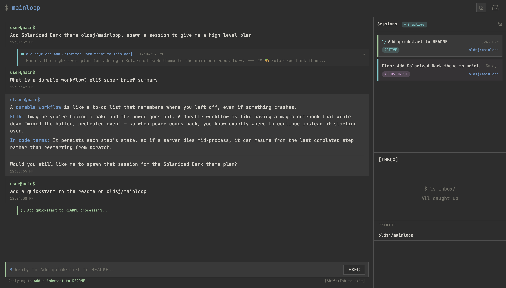
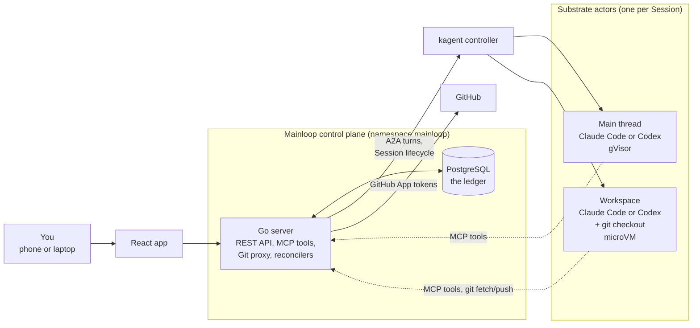
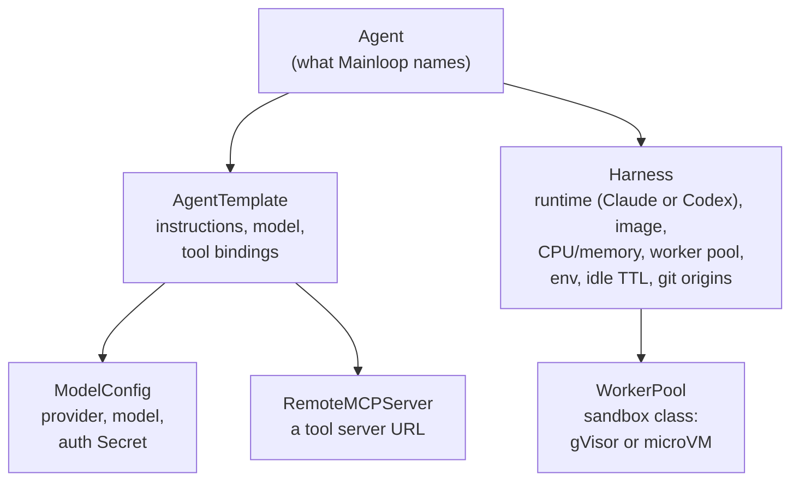
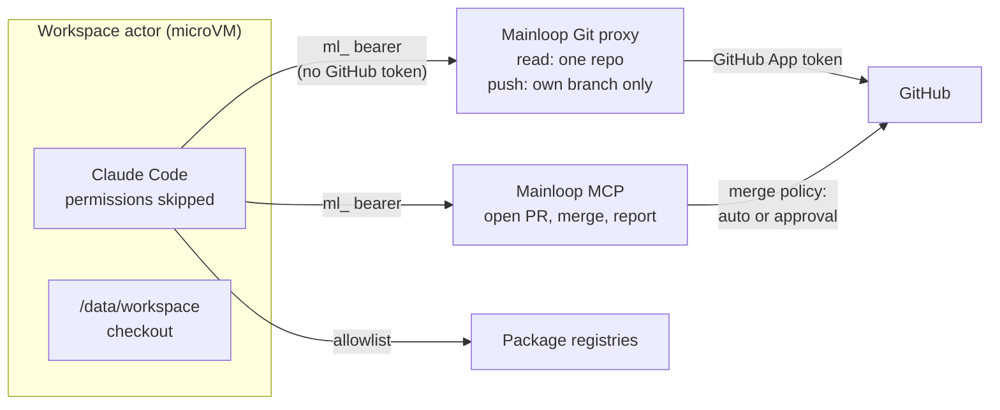
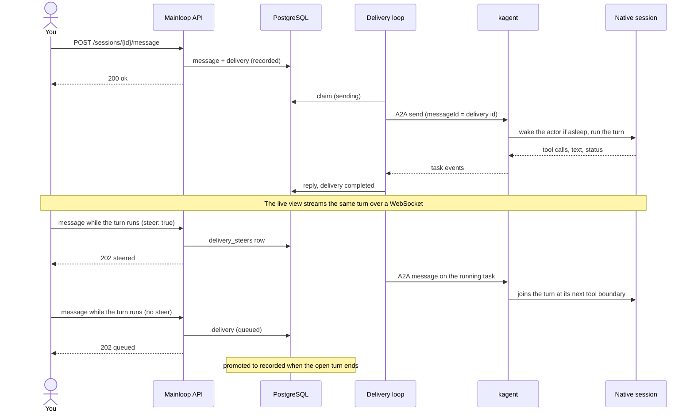

# mainloop

A single conversation to manage all of your AI sessions - that keeps working while you're away.

Your main conversation thread is the closest digital mapping to your own internal thread of consciousness. Everything else flows into a unified inbox that surfaces only what needs your attention.

Inspired by [You Are The Main Thread](https://claudelog.com/mechanics/you-are-the-main-thread/) — you are the bottleneck, so spawn parallel AI sessions and let them handle the work while you stay in flow.

| Desktop                                                                  | Mobile                                                                                                                          |
| ------------------------------------------------------------------------ | ------------------------------------------------------------------------------------------------------------------------------- |
|  |  |

## How it works

### The big picture



Mainloop is the control plane: it records every message, delivery, task and approval in PostgreSQL, then hands each turn to kagent over A2A. kagent runs each native Claude Code or Codex session in its own Substrate actor, and the agents call back into Mainloop only through its MCP tools and Git proxy.

State lives in three places, and none of them is the actor's memory:

| What                                                | Where                                    |
| --------------------------------------------------- | ---------------------------------------- |
| Conversations, deliveries, tasks, approvals, policy | Mainloop's PostgreSQL ledger             |
| Native session history (the CLI's own transcript)   | The kagent Session and its snapshots     |
| Code                                                | Git: the workspace checkout, then GitHub |

### What a kagent agent is



An Agent is an AgentTemplate (what it does) plus a Harness (how it runs). kagent compiles the pair into an immutable revision; each Session pins one revision and runs as one Substrate actor.

The Agents Mainloop uses today (names are server settings; the resources live in the infrastructure repository):

| Agent                      | Used for                                  | Sandbox                   | Tools                                 |
| -------------------------- | ----------------------------------------- | ------------------------- | ------------------------------------- |
| `mainloop-main`            | the Claude main thread                    | gVisor, 2 CPU/2 GiB       | `mainloop`                            |
| `mainloop-main-codex`      | the Codex main thread                     | gVisor, 2 CPU/2 GiB       | `mainloop`                            |
| `claude-workspace`         | code tasks, supervisors, owner workspaces | microVM, 3 CPU/4 GiB, git | `mainloop`, `mainloop-merge-approval` |
| `codex-workspace`          | the same, on Codex                        | microVM, 3 CPU/4 GiB, git | `mainloop`, `mainloop-merge-approval` |
| `claude-subscription`      | coordination children (no repository)     | microVM, 2 CPU/2 GiB      | `mainloop`                            |
| `codex-subscription-https` | the same, on Codex                        | microVM, 2 CPU/2 GiB      | `mainloop`                            |

Infrastructure ops agents (`renovate-steward`, `alert-triage`) are kagent Agents too, but Mainloop does not start them; see [Agents and permissions](docs/architecture/agents-and-permissions.md#ops-agents).

### Sandboxes and permissions



A coding agent runs with Claude Code's permission prompts skipped (kagent's managed profile uses `bypassPermissions`), because the sandbox is the boundary. The actor holds no GitHub credential: it fetches and pushes through Mainloop's Git proxy, which lets it push only its own branch, and it opens and merges pull requests through MCP tools that apply the project's merge policy.

### A turn's life



Every message becomes a ledger row before anything is sent, and a session has at most one open turn. A message sent mid-turn either joins it (a steer) or waits as `queued` for its own turn; a steer that the turn never consumed turns into the next queued message.

More diagrams (approvals, delegation, delivery to production) and the detail behind these are in [Agents and permissions](docs/architecture/agents-and-permissions.md). Workspaces, previews and sleep are in [Architecture](docs/architecture.md).

## Quick Start

The stack is a Go server (`server/`) and a React app (`web/`). You need a PostgreSQL 16
server and an `AGENT_TOKEN_KEY` for the API. The full local setup is in
[CONTRIBUTING.md](CONTRIBUTING.md#local-development).

To run both in a local Kind cluster instead, with Docker, `kind`, `kubectl` and DevSpace
installed, run `make dev` from the repository root. The web app is then at
<http://localhost:5173> and the API at <http://localhost:8000>. See
[Kind in the development environment](docs/dev-environment.md#kind).

```bash
# API: owner API on http://localhost:8000
cd server && go run ./cmd/mainloop serve-api

# UI, in another terminal: http://127.0.0.1:5173 (forwards /api to the API)
pnpm install --frozen-lockfile --filter web...
pnpm --dir web dev
```

## GitHub API authentication

Install a private GitHub App on the repositories Mainloop should manage. Set
`GITHUB_APP_ID` to its numeric App ID and `GITHUB_APP_PRIVATE_KEY` to single-line
base64 of its unencrypted RSA PEM (at least 2048 bits), in the server's environment
(in the cluster, the `mainloop-secrets` Secret). Leading and trailing ASCII whitespace is ignored for both values;
interior whitespace is rejected. Mainloop discovers installations and mints short-lived tokens for
one repository and the requested operation's permissions. There is no PAT
or anonymous fallback. App permissions, cache behavior and the issue-helper
limitation are in [Pull requests](docs/specs/pull-requests.md). The `get_issue`,
`list_dependabot_alerts` and `check_status` read-only tools reuse the same App credential; see
[GitHub issue and Dependabot alert reads](docs/specs/github-reads.md) and
[CI checks](docs/specs/ci.md).

## Production Deployment

The [Helm chart](charts/mainloop) deploys Mainloop. Supply environment-specific domains, credentials, and storage through your own values file, and apply production changes through your GitOps workflow ([details](docs/production-rollout.md)).

The [Publish images workflow](.github/workflows/images.yml) builds and pushes
`linux/arm64` production images on every push to `main`, using native
`ubuntu-24.04-arm` runners. It can also be started with `workflow_dispatch` for a
selected ref. The `backend` image is the Go server (`server/Dockerfile`, target `prod`,
context `server/`). The `frontend` image is the React app (`web/Dockerfile`, repository-root
context); it receives `VITE_API_URL=https://mainloop-api.olds.network` at build time.

Images are published to `ghcr.io/oldsj/mainloop-backend` and
`ghcr.io/oldsj/mainloop-frontend`, tagged with the first seven characters of the
source commit SHA. Each image's job summary records the full source SHA, tag,
digest, and copyable `image@sha256:...` reference. When both image jobs succeed on `main`,
the `chart` job publishes `oci://ghcr.io/oldsj/charts/mainloop` version `0.1.<run number>`
with both digests pinned, so a deployment tracking `0.1.*` deploys each merge. Rolling back
is pinning the previous chart version
([details](docs/production-rollout.md#production-changes-are-gitops-only)).

The image jobs authenticate with `GITHUB_TOKEN` (`contents: read`,
`packages: write`) and use separate GitHub Actions caches for each image. Existing
GHCR packages must grant this repository Actions write access. New pushes cancel
older image builds for the same ref; a cancelled run may have published only one
image, so use a fully successful run for a pin update.

## Project Structure

```text
mainloop/
├── api/           # OpenAPI contract shared by server/ and web/, and the MCP tool manifest
├── server/        # Go server: API, MCP, Git transport and migrations (one binary)
├── web/           # React app and design system
├── k8s/           # Kubernetes bases, overlays and kagent integration
├── docs/          # Specs, architecture and operations notes
└── scripts/       # Development and CI helpers
```

## UI

- **Mobile**: Bottom tab bar (Chat / Explorer)
- **Desktop**: Chat with always-visible Sessions sidebar

**Chat** — your main thread with inline sessions:

- Sessions spawn as colored thread blocks in your timeline
- Session messages appear as Slack-style thread notifications
- Click to expand inline or zoom to fullscreen view
- Terminal-style prompt: `user@context$` with content on new line

**Sessions** — all background work in one place:

1. Active sessions (with live status)
2. Sessions needing input (questions, plan reviews)
3. Completed and failed sessions
4. Each session has its own conversation you can zoom into

## Documentation

**Specs** (source of truth for app behavior):

- [Chat](docs/specs/chat.md) - Main thread conversation
- [Sessions](docs/specs/sessions.md) - Background work and status
- [Layout](docs/specs/layout.md) - Mobile and desktop views
- [GitHub issue, Dependabot alert and check-run reads](docs/specs/github-reads.md) - Read-only issue/alert/check-run tools

**Guides**:

- [Architecture](docs/architecture.md) - Workspaces, delivery, previews, and agent tools
- [Agents and permissions](docs/architecture/agents-and-permissions.md) - kagent Agents, sandboxes, approvals, delegation and delivery to prod
- [Development environment](docs/dev-environment.md) - Make targets and the shared live dev instance
- [Production rollout](docs/production-rollout.md) - Production overlay, site contract and GitOps boundary
- [Performance](docs/performance.md) - Open performance items for the current stack
- [Contributing](CONTRIBUTING.md) - Local setup, development commands, and contribution guidance

## License

This project is licensed under the [Sustainable Use License v1.0](LICENSE.md) - a source-available license that allows free use for internal business, non-commercial, and personal purposes.
