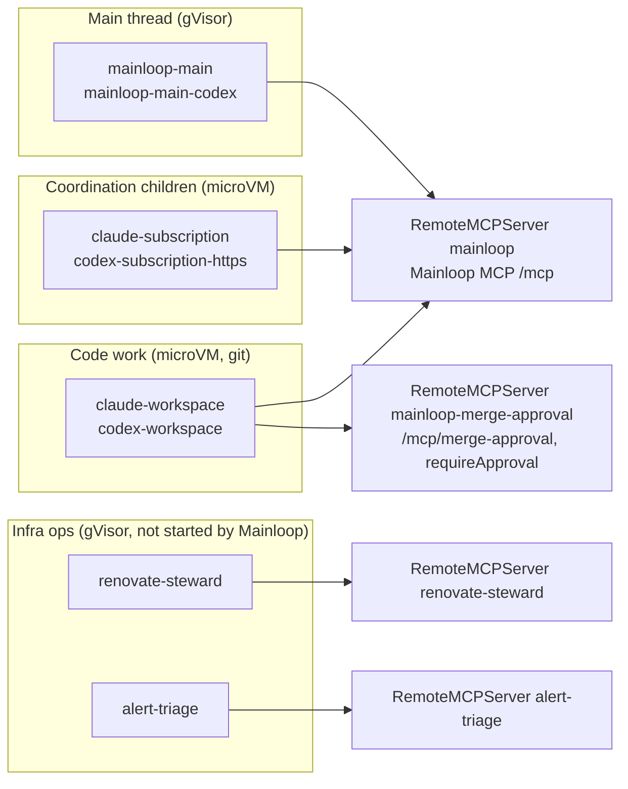
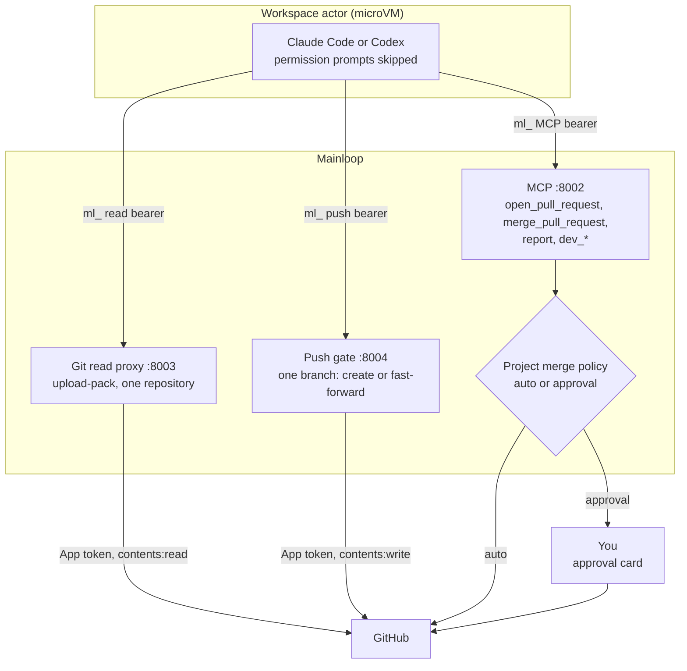
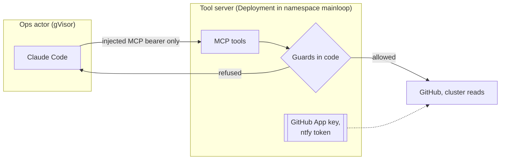
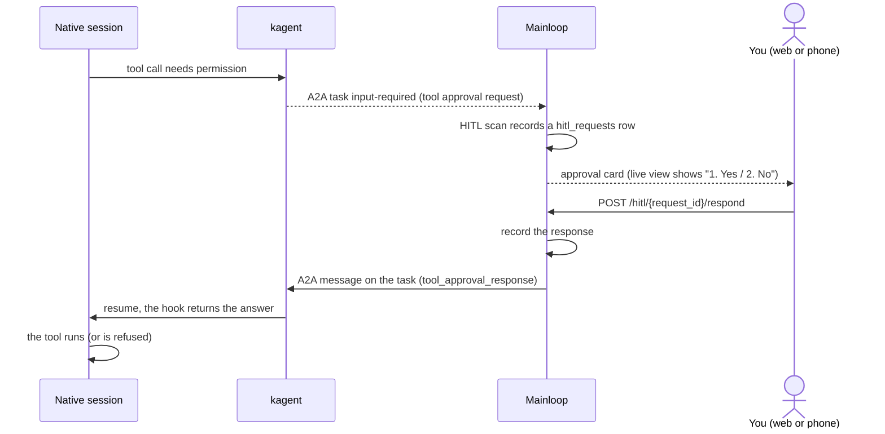
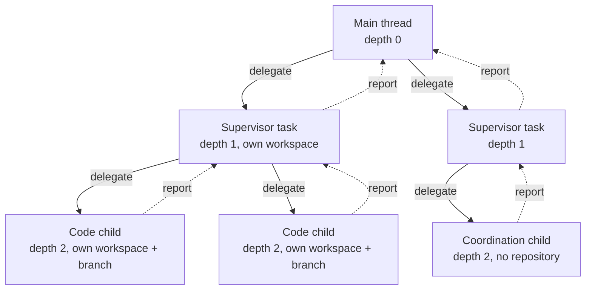
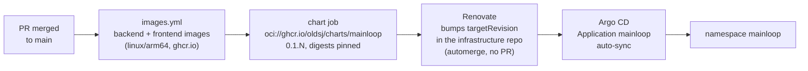

# Agents and permissions

This page explains which kagent Agents Mainloop runs, what each one may do, and how approvals,
delegation and delivery to production work. The [README](../../README.md#how-it-works) has the
overview diagrams. Workspaces, previews and sleep are in [Architecture](../architecture.md).

Status labels: **implemented** means the code path exists in this repository or the kagent fork;
**proven on prod** means it was observed working in production; **proposed** means it does not
exist yet.

## kagent building blocks

kagent's resources are in the `api.kagent.dev/v1alpha3` group, in namespace `kagent`.

| Resource          | Holds                                                                                                                                                        |
| ----------------- | ------------------------------------------------------------------------------------------------------------------------------------------------------------ |
| `AgentTemplate`   | What the agent does: instructions, a `ModelConfig` reference, tool bindings (`RemoteMCPServer`), skills, subagents.                                          |
| `Harness`         | How it runs: runtime (Claude, Codex or kagent), image, CPU and memory, `substrate.workerPoolRef`, `env`, `sessionIdleTTL`, `git.origins`, snapshot location. |
| `ModelConfig`     | Provider, model and the Secret with the provider credential.                                                                                                 |
| `RemoteMCPServer` | A tool server URL and the header kagent fills with a per-session credential.                                                                                 |
| `Agent`           | A template plus a harness. kagent compiles it into an immutable revision and reports readiness.                                                              |

The WorkerPool a harness names decides the sandbox: `kagent-default` runs gVisor, `kagent-microvm`
runs microVMs (Kata with cloud-hypervisor). Each kagent Session pins one revision and runs as one
Substrate actor. When a turn ends, or waits for input, kagent suspends the actor and snapshots its
data; the next A2A send or router connection wakes it. Processes do not survive sleep; files under
`/data` do.

## The Agents

Mainloop picks an Agent by role. The settings and their defaults are in
`server/internal/config/config.go`; the role mapping is in `server/internal/providers/registry.go`.

| Role                       | Setting                                          | Default Agent                                     |
| -------------------------- | ------------------------------------------------ | ------------------------------------------------- |
| Main thread                | `KAGENT_MAIN_AGENT`, `KAGENT_MAIN_CODEX_AGENT`   | `mainloop-main`, `mainloop-main-codex`            |
| Supervisor                 | `KAGENT_SUPERVISOR_CLAUDE_AGENT`, `_CODEX_AGENT` | `claude-workspace`, `codex-workspace`             |
| Code task, owner workspace | `KAGENT_WORKSPACE_CLAUDE_AGENT`, `_CODEX_AGENT`  | `claude-workspace`, `codex-workspace`             |
| Coordination child         | `KAGENT_CLAUDE_AGENT`, `KAGENT_CODEX_AGENT`      | `claude-subscription`, `codex-subscription-https` |

In production (infrastructure repository, `k8s/apps/kagent/base/`):

- The main harnesses run on gVisor with 2 CPU and 2 GiB and `sessionIdleTTL: 0s` (never expire).
- The workspace harnesses run on microVMs with 3 CPU and 4 GiB, `sessionIdleTTL: 0s`, and
  `git.origins: [github.com]` with read and push proxy origins pointing at Mainloop's
  `mainloop-git-read` and `mainloop-git-push` Services.
- The coordination child harnesses run on microVMs with 2 CPU and 2 GiB and the default idle TTL.
- The Claude harnesses set `KAGENT_CLAUDE_DRIVER=sdk`: one long-lived Agent SDK session per
  kagent Session, which is what makes steering and the live view possible.
- Every Mainloop Agent has the `package-registries` egress policy (npm, PyPI, the Go proxy).
- Provider credentials are subscription OAuth tokens in `ModelConfig` Secrets, owned by kagent.

## Sandboxes and permissions

There are two models, chosen by what the agent can reach.

### Coding agents: the sandbox is the boundary (implemented)

- kagent's managed Claude profile runs the SDK with `permissionMode: "bypassPermissions"`
  (`go/harness/claude/internal/driver/sdk.go` in the kagent fork). Codex runs with native approvals
  off. The owner can change the mode of a live session from the live view (Shift+Tab).
- The actor holds no GitHub credential. It holds three `ml_` bearers, one each for MCP, Git read and
  Git push. kagent injects them by origin from Secrets Mainloop publishes; Mainloop stores only
  their hashes. See [credentials](../specs/credentials.md).
- The push gate accepts exactly one update to the task's own branch per push. See
  [Git publication authority](../specs/push-gate.md).
- Merges go through `merge_pull_request`, which applies the project's merge policy (`auto` or
  `approval`). Under `approval` the agent calls `merge_pull_request_with_approval`, which is served
  alone on `/mcp/merge-approval` and bound with `requireApproval: true`, so the owner approves it.
  See [merge policy](../specs/merge-policy.md).
- The workspace cannot reach the GitHub API; egress is the package registries plus Mainloop.

### Ops agents: the model decides, the tool server says no

The infrastructure ops agents, `renovate-steward` and `alert-triage`, follow a different rule: the
session holds no service credential, and each tool server holds the credentials and refuses unsafe
actions itself.

- `renovate-steward` can merge Renovate pull requests. Its `merge_pr` tool refuses in shadow mode
  (`STEWARD_SHADOW=true`, the current setting: it comments decisions and never merges), when checks
  are not green, while another merge is being watched or merging is paused, when a stateful app has
  no recent backup, and on never-merge paths (the router, Talos, Argo CD, Cilium, cert-manager,
  gateways and similar). A merge is pinned to the head commit and reverted if the app goes unhealthy.
- `alert-triage` is read-only: alerts, logs, metrics and notes. It proposes fixes and makes none.
- Neither has a human approval gate today; the guards are code in the tool server.

### Proposed: an ops tier

**Proposed, not implemented.** A general `ops` agent that runs Claude Code in auto mode inside its
sandbox, with every write exposed only as an approval-gated MCP tool (`requireApproval: true`), so
reads are free and each mutation becomes an approval card in Mainloop.

## Approvals

**Implemented; proven on prod on 2026-11-12.**

A permission prompt becomes the A2A task's `input-required` request. Mainloop's HITL scan
(`server/internal/hitl`) records it, the web pairs the prompt with the request by permission id and
tool call id, and the answer goes through `POST /hitl/{request_id}/respond`, which records it and
answers the A2A task (`hitl.Service.ResponseLoop`).

Two cases differ in what survives sleep:

- A protected tool call (`requireApproval`) or a question in an A2A turn is **deferred**: the turn
  ends with `tool_deferred`, kagent saves the pending input, and the actor may sleep. The answer
  resumes the session and the call runs then.
- A prompt the runner holds live (outside that boundary, under the session's permission mode) waits
  in the running process and is lost if the actor sleeps.

While a turn waits for input its delivery stays open and later messages queue behind it.
See [sessions](../specs/sessions.md).

## Delegation

**Implemented.**

The main thread delegates to supervisors with the `delegate` MCP tool; a supervisor delegates to
its direct children; children cannot delegate. Each code task gets its own workspace, checkout and
branch. Agents send `report` (progress, completed, failed or blocked); reports travel through the
`task_event_deliveries` queue into the parent's session as an ordinary message, and blocked or
failed reports also reach the main thread. A report to a busy session waits as `queued`. The main
thread has no `report` tool; it asks you in chat. See [delegation](../specs/delegation.md) and
[tasks](../specs/tasks.md).

## Delivery to production

**Implemented.**

Each push to `main` publishes both images, tagged with the short commit SHA, then a chart version
that pins their digests. In the infrastructure repository, Renovate moves the `mainloop`
Application's chart `targetRevision` and commits straight to `main` without a pull request, and
Argo CD syncs it. Rolling back is pinning the previous chart version. See
[production rollout](../production-rollout.md).
